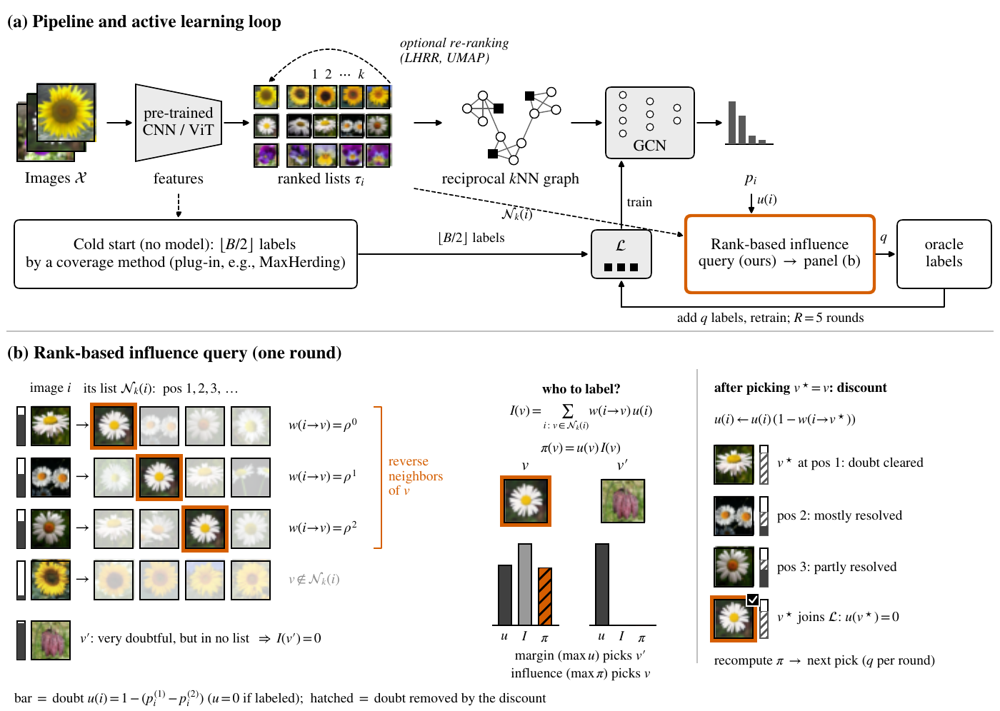

# Rank-Based Influence Queries for Low-Budget Active Learning with GCNs

Code and per-configuration results for the paper

> G. R. Letício, V. A. S. Kawai, T. C. C. Almeida, D. C. G. Pedronette.
> *Rank-Based Influence Queries for Low-Budget Active Learning with Graph Convolutional Networks.*
> Submitted to Pattern Recognition Letters, 2026.

The query labels images on which the GCN is uncertain and that appear near the top of the
ranked lists of other uncertain images, so that their labels reach many of them through the
graph; a greedy discount avoids redundant picks in the same region. It uses only the ranked
lists that define the rank-based graph and the current class probabilities, so it can follow
any cold-start method.



*(a) Ranked lists define a reciprocal kNN graph used by a GCN; a coverage method spends half of the
budget in the cold start and the rest is spent in 5 rounds of the rank-based influence query.
(b) One round of the query: the influence of a candidate sums the doubt of the images that have it
near the top of their lists, and each pick discounts the doubt of its reverse neighbors.*

All tables of the paper and of the supplementary material are generated from the CSV files in
`results/` by the scripts in `analysis/` (no number is copied by hand). Running
`python3 analysis/make_tables.py` reproduces them exactly.

## Repository layout

```
src/
  active.py          influence query (pick_rank_influence_greedy), margin, CoreSet, Rank-ProbCover
  coverage.py        ProbCover and MaxHerding cold starts
  official_ports.py  baselines ported from the authors' official code (see "Third-party code")
  selection.py       TypiClust (our reimplementation, used in exp 05)
  gcn.py, graphs.py  GCN models (SGC, GCN-Net, APPNP) and the reciprocal kNN graph
  data.py            loading of labels, features and ranked lists
  protocol.py        splits
  reliability.py     uncertainty helpers used by active.py
experiments/
  preflight.py               checks packages, data files and label alignment before a grid
  05_al_confirm/             main grid: our pipelines and our baselines
  06_al_baselines/           baselines from official code
  07_ablation_sensitivity/   ablation of the query and sensitivity to k, rho and rounds
  08_cost/                   selection time of each method
  09_budget_curves/          budgets of 1%, 3% and 7% (curves of Fig. 3)
  10_tcm_rule/               switch rule of the TCM authors
analysis/
  make_tables.py       Tables 1-3 of the paper and Tables S of the supplementary material
  make_supp_tables.py  remaining supplementary tables
  make_qualitative.py  qualitative figure (Fig. 2; needs the Corel5k images)
figures/fig1.py        overview figure (Fig. 1; needs the Flowers-17 images)
tools/make_data_package.py   builds the data package (features, labels, ranked lists)
tests/                 tests of the query against slow reference implementations, and of the
                       ported baselines against the official code
results/<exp>_server/results.csv   one row per (configuration, split, method)
```

The header of each file is in English; the comments inside the code are in Portuguese.

### Paper element → script

| Paper | Experiments | Script |
|---|---|---|
| Table 1 (influence vs. margin after the same cold start) | 05, 06 | `analysis/make_tables.py` → `plugin.tex` |
| Table 2 (all methods, original lists) | 05, 06, 10 | `analysis/make_tables.py` → `sota_none_std_mark.tex` |
| Table 3 (ablation) | 07 | `analysis/make_tables.py` → `ablation_short.tex` |
| Fig. 3 (budget curves) | 06, 09 | `FIG_H=1.9 python3 experiments/09_budget_curves/summarize.py` |
| Fig. 2 (qualitative) | — | `COLUMN=1 NCOL=5 python3 analysis/make_qualitative.py` |
| Supplementary tables (LHRR/UMAP lists, re-ranking, ablation by budget, cost) | 05–08 | `analysis/make_tables.py`, `analysis/make_supp_tables.py` |

## Installation

Experiments were run with Python 3.8.10 on a single NVIDIA RTX 2080 Ti:

```bash
python3 -m venv venv && source venv/bin/activate
pip install torch==1.12.1+cu113 --extra-index-url https://download.pytorch.org/whl/cu113
pip install -r requirements.txt
```

Other versions of PyTorch and PyTorch Geometric should work, but GCN training on the GPU is not
bit-wise deterministic (atomic operations), so accuracies may differ slightly from the CSVs; the
differences average out over the 10 splits.

## Data

Three collections are used: Flowers-17, Corel5k and CUB-200-2011, each with features from three
pre-trained networks (ResNet-152, ViT-B/16, Swin-B) and the ranked lists given by the Euclidean
distance between features. Re-ranked lists were computed with LHRR (UDLF framework) and with UMAP
used as a re-ranking method, as in Letício et al., Pattern Recognition Letters 183 (2024).

Features and ranked lists are not included in this repository. They are available from the
authors upon request. The package is built by `tools/make_data_package.py`, which copies exactly the
files read by the experiments and checks that they load identically. The expected layout (default `datasets/`, or set `DATASETS_DIR`) is

```
datasets/
  flowers/        flowers_classes.txt   (image_0001.jpg:0, one line per image)
                  Resnet152.txt, vitb16.txt, swintf_flowers.txt   (ranked lists: one line per image,
                  indices of the most similar images, the image itself first)
                  Resnet152_LHRR.txt, Resnet152_UMAP.txt, ...      (re-ranked lists)
  flowers-feat/   Resnet152.npy, vitb16.npy, swintf.npy            (features, n x d)
  corel5k/, corel5k-feat/, cub200/, cub200-feat/                   (same structure)
```

The exact file names accepted for each descriptor are listed in `src/data.py`. For Corel5k, the
order of the features and lists is given by `corel5k_lists.txt`, and `load_labels` reorders the
labels accordingly. `python3 experiments/preflight.py --reranks none LHRR UMAP` checks that all
files exist and that the labels are aligned with the lists.

## Running

Always from the repository root:

```bash
python3 tests/test_influence.py                       # query == slow reference implementation
python3 experiments/05_al_confirm/run.py --smoke      # one split of Flowers-17, ~15 s on a GPU
python3 experiments/05_al_confirm/grid.py --dry-run   # lists the jobs of the full grid
python3 experiments/05_al_confirm/grid.py             # full grid (resumable)
python3 experiments/06_al_baselines/grid.py
python3 experiments/07_ablation_sensitivity/grid.py
python3 experiments/08_cost/run.py
python3 experiments/09_budget_curves/grid.py
python3 experiments/10_tcm_rule/grid.py
python3 analysis/make_tables.py
```

New runs write to `results/<exp>/`; the analysis scripts read the shipped results in
`results/<exp>_server/`. On GPUs with little memory, set `GCN_ADJ=csr`.

`tests/test_official_equivalence*.py` check that the ported baselines select the same images as
the official code; they need a clone of the TypiClust repository:

```bash
git clone https://github.com/avihu111/TypiClust.git /tmp/TypiClust
OFFICIAL_DEEPAL=/tmp/TypiClust/deep-al python3 tests/test_official_equivalence.py
```

## Third-party code

`src/official_ports.py` contains selection code ported from the official implementations of
TypiClust, ProbCover and DCoM ([avihu111/TypiClust](https://github.com/avihu111/TypiClust), MIT),
AGE ([vwz/AGE](https://github.com/vwz/AGE), MIT), RIM ([zwt233/RIM](https://github.com/zwt233/RIM))
and Grain ([zwt233/Grain](https://github.com/zwt233/Grain)). Each function states the file it was
ported from and what was changed. Please cite the original papers when using these baselines.

## License

MIT (see `LICENSE`), except for the third-party code above, which remains under the terms of its
original authors.
